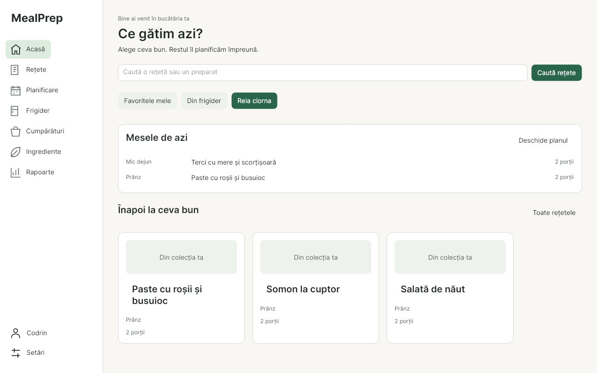

# MealPrepApp

Meal planning, recipe browsing, cooking and pantry tracking with a shared SQL Server database. Built for the UTM software engineering practicum.

- **macOS Apple Silicon and Linux x64:** Avalonia 11.3 Desktop client with Romanian labels, native window decorations, Inter typography and warm System / Light / Dark themes.
- **Windows:** the original WPF client is retained for grading and shares Core logic. The Desktop redesign does not replace its interface.
- **Database:** SQL Server 2022, accessed through stored procedures with UTC timestamps, mutation auditing and recipe concurrency checks.



[Recipe detail](docs/redesign/screenshots/recipe-Dark-1280-100.png) · [Weekly planner](docs/redesign/screenshots/planner-Light-1280-100.png) · [Design and rollout](docs/redesign/README.md) · [Validation evidence](docs/redesign/validation.md)

## Features

- Browse recipes with combined search, category, sorting, favorites, recent recipes and drafts; switch between cards and lists.
- Edit recipes with searchable ingredient selection, numeric inputs and draft/discard/stay guards for unsaved edits. Manage photos from saved recipe details.
- Scale displayed ingredients and nutrition using decimal arithmetic without changing the saved recipe. Missing nutrition data remains labelled.
- Cook with readable instruction paragraphs, temporary ingredient checkboxes and a manual timer that continues across navigation while the app stays open. Closing the app or signing out ends the cooking session.
- Plan weeks or months, use a narrow agenda, move or duplicate meals, and preview a week copy before saving. Copies preserve existing target meals and skip exact duplicates.
- Search and group pantry stock and catalog ingredients, and edit pantry quantities directly.
- Save shopping-list snapshots and purchase state per user across clients. Generate a new list without losing the old one, filter purchases, export Excel or copy plain text.
- Explicitly import a shopping item into the pantry once per snapshot item. Checking a purchase or cooking ingredient does not change stock. Only supported compatible units are normalized; incompatible units remain separate.
- View nutrition estimates, category distributions and recipe/ingredient rankings with readable tables.

## Repository

| Path | Purpose |
|---|---|
| `App/MealPrepApp.Core/` | Shared models, presentation logic, services and Dapper repositories; no UI framework dependency |
| `App/MealPrepApp.Desktop/` | Avalonia views, semantic themes, icons, settings and native dialogs |
| `App/MealPrepApp/` | Windows WPF practica client |
| `Database/` | Schema, stored procedures, seeds and additive migrations |
| `Tests/` | Headless UI/Core regressions, isolated SQL tests and updater checks |
| `scripts/` | Packaging, Linux launcher installation and backup-first database updates |
| `nix/` | [Nix setup and dependency bootstrap](nix/README.md) |
| `docs/redesign/` | [Screenshots, implementation notes and acceptance flow](docs/redesign/README.md) |
| `Raport/` | [Romanian academic report generator](Raport/README.md) |
| `Vault/` | Historical project notes and decisions |

## Downloads and release candidates

CI retains Mac/Linux archives and test results as Actions artifacts. The manually triggered **Draft release candidate** workflow verifies the selected commit before preparing a draft prerelease with checksums. A public release has not been created by this agent. See the [release procedure and acceptance evidence](docs/releases/README.md) and [candidate notes](docs/releases/v1.0.0-rc.1.md).

## Build and run

Install the .NET 10 SDK and Python 3.11+ for packaging; `global.json` selects the 10.0 SDK family. Run these commands from the repository root. Self-contained packages include the runtime, but building requires the SDK and a successful NuGet restore.

### macOS Apple Silicon

Build on the Mac or cross-publish from a .NET host, then create a transfer archive:

```bash
bash scripts/build-mac.sh -m:1 &&
tar -czf dist/MealPrepApp-macos-arm64.tar.gz -C dist/mac MealPrepApp.app
```

Transfer the archive to the Mac, extract it and replace the previous app. Launch on macOS:

```bash
open dist/mac/MealPrepApp.app
```

The script produces `dist/mac/MealPrepApp.app`; the separate `tar` command produces the archive. The bundle uses native window decorations, a native menu and file pickers. Packaging does not sign or notarize it.

### Linux x64

```bash
bash scripts/build-linux.sh -m:1
./dist/linux/MealPrepApp.Desktop
```

To install a launcher pointing to this folder:

```bash
bash scripts/install-linux.sh
```

Keep the published folder at that location, or rerun the installer after moving it. Linux uses **X11 / XWayland**, including under Hyprland; this version has no native Wayland backend. NixOS users should follow the [Nix README](nix/README.md) for native-library dependencies and the package bootstrap.

### Development

```bash
dotnet run --project App/MealPrepApp.Desktop
```

### Windows WPF

On Windows with the .NET 10 SDK:

```powershell
dotnet build App/MealPrepApp/MealPrepApp.csproj -c Release
dotnet run --project App/MealPrepApp/MealPrepApp.csproj
```

To publish the practica executable, run `App\publish-windows-exe.cmd`. Output: `App/publish/MealPrepApp-win-x64/MealPrepApp.exe`.

## Connection settings

Deploy the database before using the client. Desktop loads `appsettings.json`, the first matching development/local override, then the per-user override. Configure the connection through **Setări** after signing in, or create the per-user file before the first login:

| Platform | Typical per-user directory |
|---|---|
| macOS | `~/Library/Application Support/MealPrepApp/` |
| Linux | `~/.local/share/MealPrepApp/` |

The actual directory follows .NET `LocalApplicationData` and platform environment settings. Put `appsettings.Local.json` there using `App/MealPrepApp.Desktop/appsettings.Local.template.json` as a template. Development also probes `App/MealPrepApp.Desktop/appsettings.Local.json` when launched from the repository root. WPF uses its own local template under `App/MealPrepApp/`.

```json
{
  "ConnectionStrings": {
    "MealPrepDB": "Server=<server-tailscale-ip>,1433;Database=MealPrepDB;User Id=mealprep_app;Password=<deployment-password>;TrustServerCertificate=True;Encrypt=True"
  }
}
```

For the home-server deployment, obtain its current Tailscale IPv4 on the server with `tailscale ip -4`. The client must be able to reach that host on TCP 1433. Use a comma before the SQL port. Connection changes saved in settings require restarting the app.

Local credentials are gitignored and excluded from published packages. Theme, recipe-view and reduced-motion choices live separately in `preferences.json`. Redacted diagnostics live in the per-user `MealPrepApp/logs/` directory.

## Database setup and upgrades

Docker Compose starts SQL Server; it does not automatically execute `run_all.sql`.

### Existing database

Run the disposable suite first from a Docker-capable shell. After it passes, close desktop clients and apply both updates on the database host:

```bash
bash scripts/test-database.sh &&
bash scripts/update-database.sh mealprep-db &&
bash scripts/update-database.sh mealprep-db 20261028_cooking_redesign.sql
```

Each update creates a copy-only checksum backup, verifies it and copies it to gitignored `backups/` before migration. Backup failure stops the update. These migrations preserve existing users, data and login credentials; the second adds saved shopping lists and week copying. Use this path for an existing deployment. [Detailed rollout and acceptance checks](docs/redesign/README.md#database-rollout).

### New database

Set `MSSQL_SA_PASSWORD` in the deployment environment, then start the container:

```bash
docker compose -f docker-compose.db.yml up -d
```

Once SQL Server is ready, initialize from the mounted schema directory, supplying a separate application-login password. The command below prompts for it and keeps the administrator password inside the container:

```bash
read -r -s -p 'New application-login password: ' MEALPREP_APP_PASSWORD
printf '\n'
printf '%s\n' "$MEALPREP_APP_PASSWORD" |
  docker exec -i -w /docker-entrypoint-initdb.d mealprep-db sh -c '
    IFS= read -r MEALPREP_APP_PASSWORD
    export SQLCMDPASSWORD="$MSSQL_SA_PASSWORD"
    exec /opt/mssql-tools18/bin/sqlcmd -S localhost -U sa -C -b \
      -v AppPassword="$MEALPREP_APP_PASSWORD" -i run_all.sql
  '
unset MEALPREP_APP_PASSWORD
```

Use a SQL-policy-compliant password without single quotes or newlines: the initialization script interpolates it into the login-creation SQL. `run_all.sql` includes schema, seeds and procedures; repeatability is covered by the disposable test suite. Existing login passwords are not rotated by initialization. Credential rotation is a separate deployment operation.

## Verification

```bash
dotnet test Tests/MealPrepApp.Tests/MealPrepApp.Tests.csproj -c Release
dotnet run --project Tests/MealPrepApp.RegressionRunner -c Release
python3 Tests/Scripts/test_database_update.py
python3 Tests/Scripts/check_redesign_contrast.py
bash scripts/test-database.sh
```

The direct runner works in environments where VSTest cannot create its local TCP listener. It does not replace standard test discovery. To regenerate the screenshot matrix from database-free fixtures:

```bash
dotnet run --project Tests/MealPrepApp.RegressionRunner -c Release -- --screenshots
```

The redesign has a successful Release build, **21 direct regression checks**, **28 contrast checks**, **72 shell renders** across two themes, three sizes and three render DPIs, and successful macOS/Linux packaging. GitHub Actions is configured for cross-platform tests, Windows WPF compilation, packaging and disposable SQL checks.

Codrin reports the expanded SQL suite and both live migrations passed from normal SSH. Independent deployed inspection, WPF compilation and the full native macOS/Hyprland acceptance flow still require verification outside the restricted build environment. Codrin reports the rebuilt app looks good; this does not establish every acceptance check. The agent has not applied the database migrations. See [current evidence and limitations](docs/redesign/validation.md) and the [earlier compatibility repair history](docs/compatibility-repair.md).

## Architecture and scope

Core remains platform-neutral, and repositories call parameterized stored procedures rather than direct table DML. The application database role denies direct table access. Stored procedures enforce recipe ownership and optimistic concurrency, record mutation audits and use UTC timestamps.

The existing architecture trusts desktop clients with shared database access and user IDs; UI sign-in is not a server-enforced authentication boundary. Household sharing, expiry batches, nutrition goals, URL import, AI planning and a web frontend are outside this redesign.

Created for coursework at the Technical University of Moldova, FCIM.
