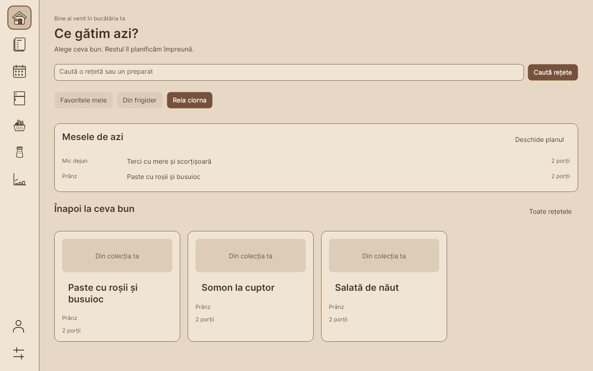

# MealPrepApp

Meal planning, recipe browsing, cooking and pantry tracking with a shared SQL Server database. Built for the UTM software engineering practicum.

- **Windows x64, macOS Apple Silicon, and Linux x64:** Avalonia 11.3 Desktop client with Romanian labels, native window decorations, Inter typography and warm System / Light / Dark themes.
- **Grading:** the original Windows WPF client is retained alongside Avalonia and shares Core logic. See the [Windows guide](docs/platforms/windows.md#wpf-grading-client).
- **Database:** SQL Server 2022, accessed through stored procedures with UTC timestamps, mutation auditing and recipe concurrency checks.



[Recipe detail](docs/refinement/screenshots/recipe-Dark-1280-100.png) · [Weekly planner](docs/refinement/screenshots/planner-Light-1280-100.png) · [Design and rollout](docs/redesign/README.md) · [Current visual refinement and validation](docs/refinement/README.md) · [Earlier validation evidence](docs/redesign/validation.md)

## Features

- Browse recipes with combined search, category, sorting, favorites, recent recipes and drafts; switch between cards and lists.
- Edit recipes with searchable ingredient selection, numeric inputs and draft/discard/stay guards for unsaved edits. Manage photos from saved recipe details.
- Scale displayed ingredients and nutrition using decimal arithmetic without changing the saved recipe. Missing nutrition data remains labelled.
- Cook with readable instruction paragraphs, temporary ingredient checkboxes and a manual timer that continues across navigation while the app stays open. Closing the app or signing out ends the cooking session.
- Plan weeks or months, use a narrow agenda, move or duplicate meals, and preview a week copy before saving. Copies preserve existing target meals and skip exact duplicates.
- Browse pantry stock through illustrated fridge categories, search and sort locally, edit quantities, and find recipes from your stock. Search and group catalog ingredients.
- Save shopping-list snapshots and purchase state per user across clients. Generate a new list without losing the old one, filter purchases, export Excel or copy plain text.
- Explicitly import a shopping item into the pantry once per snapshot item. Checking a purchase or cooking ingredient does not change stock. Only supported compatible units are normalized; incompatible units remain separate.
- View nutrition estimates, category distributions and recipe/ingredient rankings with readable tables.

## Repository

| Path | Purpose |
|---|---|
| `App/MealPrepApp.Core/` | Shared models, presentation logic, services and Dapper repositories; no UI framework dependency |
| `App/MealPrepApp.Desktop/` | Avalonia views, semantic themes, icons, settings and native dialogs |
| `App/MealPrepApp/` | Windows WPF practica client |
| `Database/` | Schema, stored procedures, seeds and additive migrations |
| `Tests/` | Headless UI/Core regressions, isolated SQL tests and updater checks |
| `scripts/` | Platform builds, installation, release validation and backup-first database updates |
| `packaging/` | Windows installer definition |
| `docs/platforms/` | Windows, macOS, and Linux installation and development guides |
| `nix/` | [Nix setup and dependency bootstrap](nix/README.md) |
| `docs/redesign/` | [Screenshots, implementation notes and acceptance flow](docs/redesign/README.md) |
| `Raport/` | [Romanian academic report generator](Raport/README.md) |
| `Vault/` | Historical project notes and decisions |

## Install and run

`main` is the single maintained branch for every OS. Download packages from
[Releases](https://github.com/Sklizm/MealPrepApp/releases). Before a release is published,
successful **Compatibility** runs under GitHub Actions retain platform packages as artifacts.

| Platform | Package and instructions |
|---|---|
| Windows x64 | [Setup executable, Start Menu integration, updates and uninstall](docs/platforms/windows.md) |
| macOS Apple Silicon | [App bundle and Applications installation](docs/platforms/macos.md) |
| Linux x64 / NixOS | [Standalone folder, launcher and native dependencies](docs/platforms/linux.md) |

Packages include the .NET runtime. They require access to an existing SQL Server deployment;
they do not install or migrate the database. See [release preparation](docs/releases/README.md)
for build provenance, checksums, and native acceptance requirements.

## Development

Install Git, .NET 10 SDK, and Python 3.11+; `global.json` selects the .NET 10 SDK family.
Windows installer builds additionally require PowerShell 7 and Inno Setup 6.4.3.
Platform guides contain complete packaging commands.

```bash
git clone --branch main https://github.com/Sklizm/MealPrepApp.git
cd MealPrepApp
dotnet run --project App/MealPrepApp.Desktop
```

Work directly on `main`, pull before changing files, and run relevant checks before pushing.
Preserve Git history. The [contributor guide](CONTRIBUTING.md) covers verification,
branch consolidation, releases, and the retained WPF grading client.

## Connection settings

A fresh installation opens **Conexiune la baza de date** before login. Enter the server
as `address,port`, database, SQL username, and password supplied by the administrator.
Use **Testează conexiunea**, then **Salvează și continuă**. Saving proceeds to login
without restarting; it is allowed while the server is temporarily unreachable.

The login screen always offers **Conexiune la baza de date** so connection failures can
be corrected before signing in. The same editor is available from **Setări**; changes
made during a signed-in session apply after restarting.

For the home-server deployment, obtain its current Tailscale IPv4 on the server with
`tailscale ip -4`. Connect the client to Tailscale and use that address with TCP port 1433.
The optional certificate-trust checkbox is for a known server with its own certificate;
connection encryption stays enabled. Database access credentials are separate from your
MealPrepApp account credentials.

Settings, preferences, and redacted diagnostic logs are stored per user:

| Platform | Typical directory |
|---|---|
| Windows | `%LOCALAPPDATA%\MealPrepApp\` |
| macOS | `~/Library/Application Support/MealPrepApp/` |
| Linux | `~/.local/share/MealPrepApp/` |

The actual directory follows .NET `LocalApplicationData` and platform environment settings.
Connection settings use `appsettings.Local.json`; appearance uses `preferences.json`;
logs are under `logs/`. Credentials are excluded from Git, release packages, and diagnostics.
Updating or uninstalling the app preserves these files.

Manual configuration remains supported using
`App/MealPrepApp.Desktop/appsettings.Local.template.json`. Desktop loads `appsettings.json`,
the first matching development/local override, then the per-user override. Missing,
placeholder, or malformed settings open connection setup. WPF retains its separate template
under `App/MealPrepApp/`; see the Windows grading instructions.

## Database setup and upgrades

Docker Compose starts SQL Server; it does not automatically execute `run_all.sql`.

### Existing database

Run the disposable suite first from a Docker-capable shell. After it passes, close desktop clients and apply both updates on the database host:

```bash
bash scripts/test-database.sh &&
bash scripts/update-database.sh mealprep-db &&
bash scripts/update-database.sh mealprep-db 20261028_cooking_redesign.sql
```

Each update creates a copy-only checksum backup, verifies it and copies it to gitignored `backups/` before migration. Backup failure stops the update. These migrations preserve existing users, data and login credentials; the second adds saved shopping lists and week copying. Use this path for an existing deployment. [Detailed rollout and acceptance checks](docs/redesign/README.md#database-rollout).

### New database

Set `MSSQL_SA_PASSWORD` in the deployment environment, then start the container:

```bash
docker compose -f docker-compose.db.yml up -d
```

Once SQL Server is ready, initialize from the mounted schema directory, supplying a separate application-login password. The command below prompts for it and keeps the administrator password inside the container:

```bash
read -r -s -p 'New application-login password: ' MEALPREP_APP_PASSWORD
printf '\n'
printf '%s\n' "$MEALPREP_APP_PASSWORD" |
  docker exec -i -w /docker-entrypoint-initdb.d mealprep-db sh -c '
    IFS= read -r MEALPREP_APP_PASSWORD
    export SQLCMDPASSWORD="$MSSQL_SA_PASSWORD"
    exec /opt/mssql-tools18/bin/sqlcmd -S localhost -U sa -C -b \
      -v AppPassword="$MEALPREP_APP_PASSWORD" -i run_all.sql
  '
unset MEALPREP_APP_PASSWORD
```

Use a SQL-policy-compliant password without single quotes or newlines: the initialization script interpolates it into the login-creation SQL. `run_all.sql` includes schema, seeds and procedures; repeatability is covered by the disposable test suite. Existing login passwords are not rotated by initialization. Credential rotation is a separate deployment operation.

See the [illustrated Frigider update and validation](docs/fridge/README.md) for the latest pantry layout and animation completion fix.

## Verification

```bash
dotnet test Tests/MealPrepApp.Tests/MealPrepApp.Tests.csproj -c Release
dotnet run --project Tests/MealPrepApp.RegressionRunner -c Release
python3 Tests/Scripts/test_database_update.py
python3 Tests/Scripts/test_release_package.py
python3 Tests/Scripts/test_windows_packaging.py
python3 Tests/Scripts/check_repository_paths.py
python3 Tests/Scripts/test_branch_consolidation.py
python3 Tests/Scripts/check_redesign_contrast.py
bash scripts/test-database.sh
```

The direct runner works in environments where VSTest cannot create its local TCP listener. It does not replace standard test discovery. To regenerate the screenshot matrix from database-free fixtures:

```bash
dotnet run --project Tests/MealPrepApp.RegressionRunner -c Release -- --screenshots
```

The current [visual refinement](docs/refinement/README.md) adds the illustrated rail, beige/sage palettes, request recovery and cancellation fixes. Its local evidence includes 44 direct regressions, 70 text and 16 indicator contrast checks, and 232 headless renders. Native DPI/hover acceptance and green Compatibility CI remain separate requirements. Regenerate this matrix with `--refinement-screenshots`; it writes to gitignored `dist/refinement/screenshots/`.

The earlier redesign evidence includes 21 direct regression checks, 28 contrast checks, 72 shell renders and macOS/Linux builds. New connection and installer checks are tracked in [release validation](docs/releases/README.md). GitHub Actions verifies cross-platform tests, Windows installation, WPF compilation, packaging, and disposable SQL checks. Native acceptance is recorded separately from successful builds.

Codrin reports the expanded SQL suite and both live migrations passed from normal SSH. Independent deployed inspection, WPF compilation and the full native macOS/Hyprland acceptance flow still require verification outside the restricted build environment. Codrin reports the rebuilt app looks good; this does not establish every acceptance check. The agent has not applied the database migrations. See [current evidence and limitations](docs/redesign/validation.md) and the [earlier compatibility repair history](docs/compatibility-repair.md).

## Architecture and scope

Core remains platform-neutral, and repositories call parameterized stored procedures rather than direct table DML. The application database role denies direct table access. Stored procedures enforce recipe ownership and optimistic concurrency, record mutation audits and use UTC timestamps.

The existing architecture trusts desktop clients with shared database access and user IDs; UI sign-in is not a server-enforced authentication boundary. Household sharing, expiry batches, nutrition goals, URL import, AI planning and a web frontend are outside this redesign.

Created for coursework at the Technical University of Moldova, FCIM.
