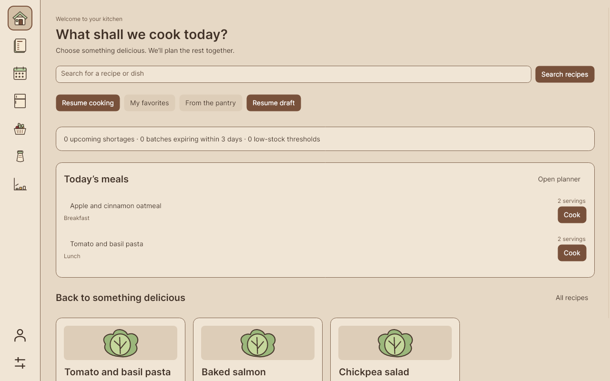
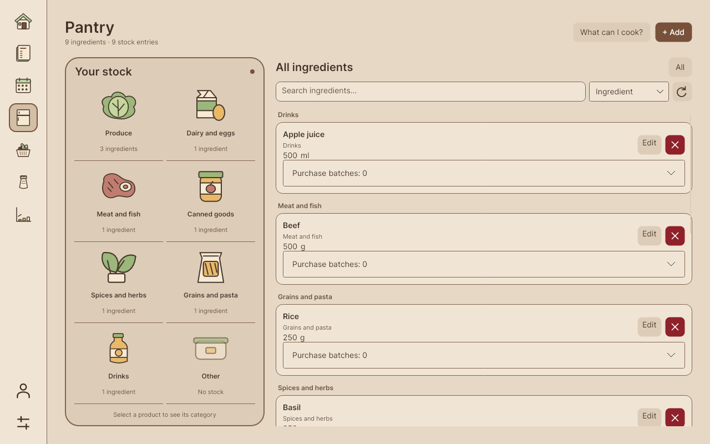

# MealPrepApp

MealPrepApp organizes recipes, meal plans, pantry stock, and shopping lists on Windows, macOS, and Linux. A native Android companion brings Shopping and Pantry to your phone through a private API. Both clients support English, Russian, and Romanian interfaces and System, Light, and Dark themes. English is the desktop default, including upgrades without a saved language.

[](https://github.com/Sklizm/MealPrepApp/actions/workflows/compatibility.yml)



[Download](https://github.com/Sklizm/MealPrepApp/releases) · [Windows](docs/platforms/windows.md) · [macOS](docs/platforms/macos.md) · [Linux](docs/platforms/linux.md) · [Android](docs/companion/ANDROID.md) · [Contributing](CONTRIBUTING.md)

## Features

- **Recipes:** search and filter your collection, save favorites, manage photos, and scale quantities and nutrition to your servings. Review imports from pasted text or supported recipe pages, and restore local recovery drafts.
- **Cooking:** follow numbered steps, retain ingredient checkmarks, and run several named timers. Review actual production and ingredient deductions when finishing, then track leftover portions and explicit waste.
- **Meal planning:** organize a week or month, move and duplicate meals, preview copied weeks, and reuse weekly templates. Allocate one cooking batch across meals so shopping counts its ingredients once.
- **Ingredients:** browse a searchable catalog by category, sort by name or missing nutrition, and edit nutrition values while preserving ingredient identity and recipe quantities.
- **Pantry:** browse illustrated food categories, inspect purchase batches with optional purchase and expiry dates, review stock corrections, and find recipes using available quantities.
- **Shopping lists:** generate and reopen saved lists, add manual groceries, record actual purchased quantities separately from requirements, copy text or export to Excel, and review purchases before importing them into pantry stock.
- **Reports:** review nutrition estimates, meal-category breakdowns, recipe and ingredient rankings, shortages, and planned, cooked, consumed, or discarded activity. Missing nutrition data is clearly labeled.



Checking a shopping item or a cooking ingredient does not change pantry quantities. Importing a purchased item is an explicit action and cannot add the same saved item twice. Compatible units are normalized; incompatible units remain separate.

See [inventory, batch cooking and recovery](docs/WORKFLOWS.md) for the desktop workflows and the [Android companion guide](docs/companion/ANDROID.md) for offline Shopping and Pantry. The [private API guide](docs/companion/API.md) covers server setup.

## Install and run

| Platform | Download | Guide |
|---|---|---|
| Windows x64 | `MealPrepApp-<version>-windows-x64-setup.exe` | [Install, update, and uninstall](docs/platforms/windows.md) |
| macOS Apple Silicon | `MealPrepApp-macos-arm64.tar.gz` | [Install the app bundle](docs/platforms/macos.md) |
| Linux x64 | `MealPrepApp-linux-x64.tar.gz` | [Run the app and configure a launcher](docs/platforms/linux.md) |

Download packages from [Releases](https://github.com/Sklizm/MealPrepApp/releases). Before a release is published, successful **Compatibility** runs in GitHub Actions provide platform packages as build artifacts. Compare downloaded files with the release's `SHA256SUMS` when available.

Desktop packages include the .NET runtime and require a reachable SQL Server database. Desktop installation does not provision the database; follow the [database setup guide](docs/database.md) for a new deployment.

Quit the app before updating. Connection settings and preferences are stored separately from the installation and survive updates and uninstall.

## Android companion

The companion supports Android 8 and later and uses your existing MealPrepApp account
through a private HTTPS API. Ask the server administrator for its address and connect
to the required private network or VPN before signing in. Recipe editing, meal planning,
cooking, and reports remain desktop workflows.

Open a saved shopping list while connected, then edit its checklist, actual purchased
quantities, and manual groceries offline. Changes are stored locally and queued for
synchronization; conflicts require review. Cached pantry stock remains readable offline.
Pantry imports, stock corrections, thresholds, and new saved lists require connectivity.
Optional expiry reminders use device scheduling and notification permissions.

See the [Android guide](docs/companion/ANDROID.md) for setup, offline behavior, reminders,
and signed builds, and the [API guide](docs/companion/API.md) for server deployment.
CI provides debug APKs in the `android-checks` artifact; release APKs require a separate
signed build. Keep the same signing key for in-place updates.

## Language and appearance

On desktop, open **Settings → Language** and choose **English**, **Русский**, or **Română**.
The interface changes immediately and remembers the choice. Switching preserves your
current page, unsaved edits, filters, cooking timer, and shopping checkmarks.
Dates and numbers follow your system region; day and month names follow the selected
language. Recipe content, ingredient names, custom categories, notes, and units remain
as entered. Known built-in categories have translated display labels.

## Connection settings

A fresh desktop installation opens **Database connection** before login. Enter the server
as `address,port`, database, SQL username, and password supplied by the administrator.
Use **Test connection**, then **Save and continue**. Saving proceeds to login
without restarting; it is allowed while the server is temporarily unreachable.

The login screen always offers **Database connection** so connection failures can
be corrected before signing in. The same editor is available from **Settings**; changes
made during a signed-in session apply after restarting.

Use a hostname or IP address reachable from the client and the SQL Server TCP port
(default: 1433). If your deployment uses a VPN, connect to it before testing the connection.
The optional certificate-trust checkbox is for a known server with its own certificate;
connection encryption stays enabled. Database access credentials are separate from your
MealPrepApp account credentials.

Settings, preferences, and redacted diagnostic logs are stored per user:

| Platform | Typical directory |
|---|---|
| Windows | `%LOCALAPPDATA%\MealPrepApp\` |
| macOS | `~/Library/Application Support/MealPrepApp/` |
| Linux | `~/.local/share/MealPrepApp/` |

The actual directory follows .NET `LocalApplicationData` and platform environment settings.
Connection settings use `appsettings.Local.json`; appearance and language use `preferences.json`;
logs are under `logs/`. Credentials are excluded from Git, release packages, and diagnostics.
Updating or uninstalling the app preserves these files.

Manual configuration remains supported using
`App/MealPrepApp.Desktop/appsettings.Local.template.json`. Desktop loads `appsettings.json`,
the first matching development/local override, then the per-user override. Missing,
placeholder, or malformed settings open connection setup. WPF retains its separate template
under `App/MealPrepApp/`; see the [legacy WPF instructions](docs/platforms/windows.md#legacy-wpf-client).

## Build from source

Install Git, the .NET 10 SDK, and Python 3.11+. Then run:

```bash
git clone --branch main https://github.com/Sklizm/MealPrepApp.git
cd MealPrepApp
dotnet run --project App/MealPrepApp.Desktop
```

The app opens connection setup when no valid local configuration exists. Platform guides cover self-contained builds, native dependencies, and installers. The [contributor guide](CONTRIBUTING.md) describes the project layout and development checks; [NixOS instructions](nix/README.md) cover the development shell and package bootstrap.

For Android, install JDK 17, Android SDK platform 35, build tools 35.0.0, and platform
tools. Use the pinned Gradle wrapper:

```bash
cd App/MealPrepApp.Android
./gradlew :app:testDebugUnitTest :app:lintDebug :app:assembleDebug :app:assembleDebugAndroidTest
```

Device and emulator tests use `./gradlew :app:connectedDebugAndroidTest` separately.
See [Android signing and distribution](docs/companion/ANDROID.md#build-and-sign).

## Database setup and upgrades

The database runs separately from the app. Follow [database setup and upgrades](docs/database.md) to initialize a new database or apply migrations to an existing deployment. Existing deployments use a verified-backup-first updater; client installers never run server migrations.

## Verification

```bash
dotnet test Tests/MealPrepApp.Tests/MealPrepApp.Tests.csproj -c Release
python3 Tests/Scripts/check_redesign_contrast.py
python3 Tests/Scripts/test_api_runner.py
bash scripts/test-database.sh
bash scripts/test-api.sh
```

The SQL and API scripts require Docker and use fresh disposable SQL Server containers.
The API script builds its checks and the API before starting the container.

[Compatibility CI](.github/workflows/compatibility.yml) runs desktop tests on Windows,
macOS, and Linux; builds the legacy WPF client; checks platform packages, Windows
installation, and combined release integrity; and runs localization, presentation,
SQL, and API checks. Android CI installs the SDK packages listed above explicitly,
runs JVM tests and lint, and builds debug and instrumentation APKs.

See [all contributor checks](CONTRIBUTING.md#checks), the [release process](docs/releases/README.md), [UI validation and screenshots](docs/README.md), and [companion verification](docs/companion/VERIFICATION.md). CI builds do not run Android device tests or establish physical-phone acceptance. Native desktop acceptance remains separate from headless rendering and cross-builds. Release publication is manual.

## Architecture

The Avalonia desktop client shares platform-independent models, presentation logic, and repositories in `MealPrepApp.Core`. SQL Server access uses parameterized stored procedures with UTC timestamps, mutation auditing, and optimistic concurrency for recipe editing. A [legacy WPF client](docs/platforms/windows.md#legacy-wpf-client) remains available from source.

The Kotlin/Jetpack Compose Android companion uses Room for cached data and queued
shopping changes, and WorkManager for synchronization attempts. Its authenticated
ASP.NET Core API enforces account ownership and version checks before stored-procedure
access to SQL Server. SQL credentials and the API token key stay on the server.

Desktop clients connect directly to SQL Server using a shared application login. UI sign-in does not provide a separate server-side authorization boundary. Deploy the database on a trusted network with appropriate access controls.
