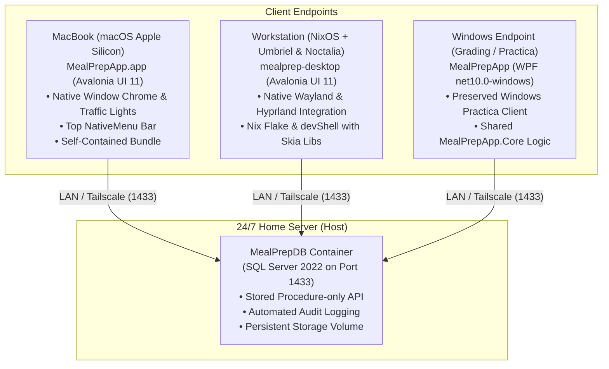

# MealPrepApp — Cross-Platform Meal Planning & Nutrition Tracker

[](https://dotnet.microsoft.com/)
[](https://avaloniaui.net/)
[](https://learn.microsoft.com/en-us/dotnet/desktop/wpf/)
[](https://www.microsoft.com/sql-server)
[%20%7C%20Windows-brightgreen)](#multi-device-topology)

**MealPrepApp** is an enterprise-grade desktop meal planning, recipe inventory, pantry tracker, and nutritional estimation application. Originally created for Windows with WPF, it features a modern multi-project cross-platform architecture running natively on **macOS (Apple Silicon)**, **Linux (NixOS / Wayland)**, and **Windows**, powered 24/7 by a central **SQL Server** database on a home server.

---

## Multi-Device Topology



---

## Solution Architecture

The solution uses a clean, decoupled MVVM architecture targeting `.NET 10`:

```text
MealPrepApp/
├── App/
│   ├── MealPrepApp.Core/          # Target: net10.0 (Pure C# Library)
│   │   ├── Models/                # 12 domain DTOs (Recipe, Ingredient, Pantry, MealPlan, Nutrition)
│   │   ├── Data/                  # SqlConnectionFactory, Dapper repositories, custom exceptions
│   │   ├── Services/              # Cross-platform abstractions (IFilePickerService, IDialogService, Session)
│   │   └── ViewModels/            # 37 ViewModels decoupled from platform APIs
│   │
│   ├── MealPrepApp.Desktop/       # Target: net10.0 (Avalonia UI 11.2)
│   │   ├── Views/                 # ShellWindow, Auth, Acasa, Retete, Ingrediente, Planificare, Rapoarte
│   │   ├── Themes/                # Forest, Moss, Cream, and Dark visual design system
│   │   ├── Converters/            # Platform converters (Image, Date, Opacity, Category Brushes)
│   │   ├── Services/              # DesktopDialogService, DesktopFilePickerService (IStorageProvider)
│   │   └── Assets/                # Info.plist (macOS), mealprep.desktop (Linux)
│   │
│   └── MealPrepApp/               # Target: net10.0-windows (WPF Practica Client)
│       ├── Views/                 # Preserved WPF XAML windows and user controls
│       └── Services/              # WpfFilePickerService, WPF DialogService
│
├── Database/                      # SQL Server 2022 schema, procs, seeds, and run_all.sql
├── scripts/
│   ├── build-mac.sh               # Builds self-contained MealPrepApp.app bundle for macOS (arm64)
│   └── build-linux.sh             # Publishes standalone Linux x64 binary
├── docker-compose.db.yml          # Home server Docker Compose service for SQL Server 2022
├── flake.nix                      # NixOS flake with required graphics & font libraries
├── shell.nix                      # Classic Nix development shell
├── MealPrepApp.slnx               # Modern unified .NET 10 solution file
└── Vault/                         # Project memory & design decisions (Obsidian)
```

---

## Core Features

### 1. User Authentication & Security
- **Proc-Only Database API:** Direct table access (`SELECT`, `INSERT`, `UPDATE`, `DELETE`) is explicitly `DENIED` to the application login. All operations run through parameterized stored procedures.
- **BCrypt Password Hashing:** Salted hashing with client-side verification.
- **Account Lockout:** 5 consecutive failed login attempts trigger an automatic 15-minute SQL-level account lockout.
- **Password History:** Enforces password rotation by preventing reuse of the last 3 passwords.
- **Audit Logging:** Every mutating database action writes an event to `AuditLog`.

### 2. Recipes & Smart Inventory
- **Full Recipe Management:** Preparation time, cooking time, category, instructions, notes, and structured ingredient rows.
- **Optimistic Concurrency:** Uses SQL Server `ROWVERSION` (`TIMESTAMP`) tokens to detect and prevent stale overwrite conflicts.
- **Photo Storage:** Stores optimized JPEG image bytes directly in the database.
- **Recipe Drafts:** Save work-in-progress recipes and resume editing later.
- **Ingredient Matching:** "What can I cook with these ingredients?" multi-parameter search.

### 3. Fridge (`Frigider`) & Dynamic Shopping Lists
- **Pantry Tracking:** Real-time user inventory with unit conversions (g/kg, ml/l).
- **Intelligent Upsert:** Adding existing ingredients in the fridge increments quantities automatically.
- **Automated Shopping List:** Calculates total ingredients required for planned meals across a custom date range, automatically subtracting what is already on hand in the fridge.
- **Excel Export:** Generates formatted `.xlsx` spreadsheets using `ClosedXML`.

### 4. Interactive Meal Planning
- **Weekly View:** 7-day × 4-slot grid (Breakfast, Lunch, Dinner, Snack) with colored meal category badges.
- **Monthly Calendar:** 6×7 interactive calendar grid with per-day meal badges and today-highlighting.
- **Fast Rescheduling:** Drag, edit, or reassign meals on the fly.

### 5. Nutrition Analysis
- **Automatic Calculations:** Caloric, protein, carbohydrate, and fat breakdown per recipe and per serving.
- **Unit Normalization:** Automatic conversion between weight, volume, and count units.
- **Missing Data Alerts:** Flags ingredients missing nutritional baselines rather than guessing values.

### 6. Reports & Statistics
- **Monthly Overview:** Headline KPIs for total meals planned, distinct recipes cooked, and ingredient variety.
- **Category Breakdown:** Distribution of breakfasts, lunches, dinners, and snacks.
- **Top Rankings:** Top 5 planned recipes and Top 10 frequently used ingredients.
- **Printable Overviews:** Dedicated views for weekly meal printouts and shopping lists.

---

## Getting Started

### 1. Database Setup (Home Server)

Launch the SQL Server 2022 container:

```bash
docker compose -f docker-compose.db.yml up -d
```

Initialize the database schema, stored procedures, and initial seed data:

```bash
docker exec -w /docker-entrypoint-initdb.d mealprep-db \
  /opt/mssql-tools18/bin/sqlcmd -S localhost -U sa -P 'MealPrepSecure2026!' -C -b -i run_all.sql
```

The script is **completely idempotent** and safe to execute against an existing database.

---

### 2. Local Configuration

Both the Avalonia desktop app and the WPF app read connection settings from `appsettings.Local.json` (which is gitignored to keep credentials private).

Copy the template:

```bash
cp App/MealPrepApp.Desktop/appsettings.Local.template.json App/MealPrepApp.Desktop/appsettings.Local.json
```

Edit `appsettings.Local.json` with your home server's IP (or Tailscale IP):

```json
{
  "ConnectionStrings": {
    "MealPrepDB": "Server=192.168.100.109,1433;Database=MealPrepDB;User Id=mealprep_app;Password=MealPrepSecure2026!;TrustServerCertificate=True;Encrypt=True"
  }
}
```

---

## Building & Running

### macOS (Apple Silicon MacBook)

To build the self-contained `.app` bundle:

```bash
./scripts/build-mac.sh
```

This creates:
```text
dist/mac/MealPrepApp.app
```
Double-click or launch from terminal:
```bash
open dist/mac/MealPrepApp.app
```

**macOS Features:**
- Extends window content into title bar with native macOS traffic lights (Close, Minimize, Zoom).
- Top screen `NativeMenu` integration for application menu items.
- High-DPI Retina support and native file picker sheets.

---

### NixOS (Workstation with Umbriel & Noctalia)

Using Nix Flakes:

```bash
# Enter the reproducible dev environment with all Skia/Wayland libraries:
nix develop

# Run the desktop app:
dotnet run --project App/MealPrepApp.Desktop
```

Or using classic `nix-shell`:

```bash
nix-shell --run "dotnet run --project App/MealPrepApp.Desktop"
```

To build a standalone package via Nix:

```bash
nix build
```

---

### Linux (Generic x64 Standalone)

To produce a single-file executable for Linux:

```bash
./scripts/build-linux.sh
```

Output binary:
```bash
./dist/linux/MealPrepApp.Desktop
```

---

### Windows (Original WPF Practica Project)

To run the WPF application on Windows:

```cmd
cd App\MealPrepApp
dotnet run
```

To publish the standalone Windows `.exe`:

```cmd
App\publish-windows-exe.cmd
```

Output:
```text
App\publish\MealPrepApp-win-x64\MealPrepApp.exe
```

---

## Architectural Rules

- **Zero Direct Table DML:** Only stored procedures may be called from C# repositories.
- **Portable ViewModels:** ViewModels in `MealPrepApp.Core` must never reference WPF (`System.Windows`), Avalonia (`Avalonia.*`), or platform-specific file dialogs.
- **UTC Everywhere:** Timestamps are stored in UTC (`SYSUTCDATETIME()`) and converted to local time in the UI presentation layer.
- **Auditing:** All inserts, updates, and deletes record user identity and execution metadata in `AuditLog`.

---

## License

Created for academic coursework and practica at the Technical University of Moldova (UTM), Faculty of Computers, Informatics and Microelectronics (FCIM).
