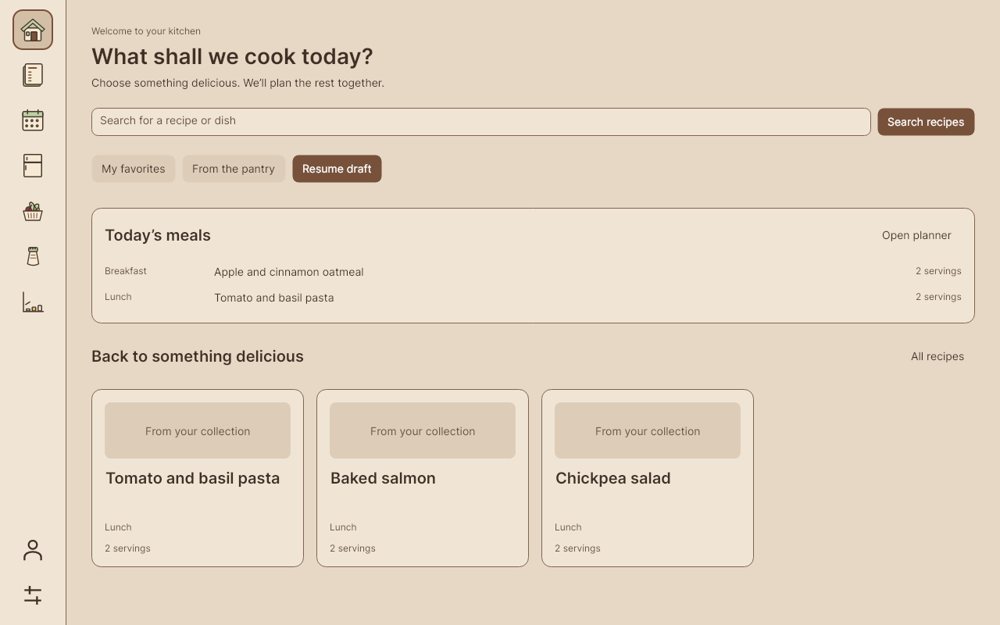
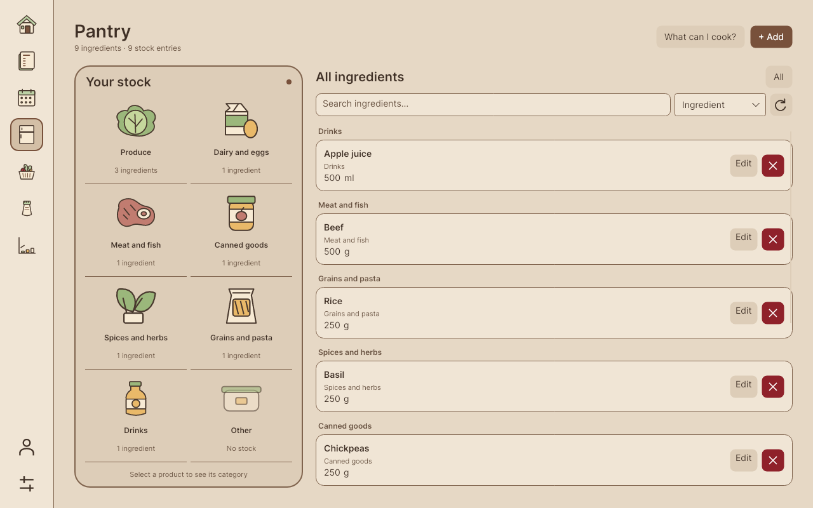

# MealPrepApp

MealPrepApp is a desktop app for organizing recipes, planning meals, tracking ingredients, and managing shopping lists. It runs on Windows, macOS, and Linux, with English, Russian, and Romanian interfaces and System, Light, and Dark themes. English is the default, including upgrades without a saved language.



[Download](https://github.com/Sklizm/MealPrepApp/releases) · [Windows](docs/platforms/windows.md) · [macOS](docs/platforms/macos.md) · [Linux](docs/platforms/linux.md) · [Contributing](CONTRIBUTING.md)

## Features

- **Recipes:** search and filter your collection, save favorites and drafts, manage photos, and scale ingredient quantities and nutrition to your servings.
- **Cooking:** follow readable instructions, check off ingredients, and keep a timer running while you navigate the app.
- **Meal planning:** organize a week or month, move and duplicate meals, and preview a week before copying it.
- **Pantry:** browse illustrated food categories, search your stock, update quantities, and find recipes using ingredients you already have.
- **Shopping lists:** generate and reopen saved lists, track purchases, copy text or export to Excel, and explicitly add purchased items to pantry stock.
- **Nutrition reports:** review estimates, meal-category breakdowns, and recipe and ingredient rankings. Missing nutrition data is clearly labeled.



Checking a shopping item or a cooking ingredient does not change pantry quantities. Importing a purchased item is an explicit action and cannot add the same saved item twice. Compatible units are normalized; incompatible units remain separate.

## Install and run

| Platform | Download | Guide |
|---|---|---|
| Windows x64 | `MealPrepApp-<version>-windows-x64-setup.exe` | [Install, update, and uninstall](docs/platforms/windows.md) |
| macOS Apple Silicon | `MealPrepApp-macos-arm64.tar.gz` | [Install the app bundle](docs/platforms/macos.md) |
| Linux x64 | `MealPrepApp-linux-x64.tar.gz` | [Run the app and configure a launcher](docs/platforms/linux.md) |

Download packages from [Releases](https://github.com/Sklizm/MealPrepApp/releases). Before a release is published, successful **Compatibility** runs in GitHub Actions provide platform packages as build artifacts. Compare downloaded files with the release's `SHA256SUMS` when available.

Packages include the .NET runtime. A reachable SQL Server database is required; the app does not offer an offline database or provision a server during installation. For a new deployment, follow the [database setup guide](docs/database.md).

Quit the app before updating. Connection settings and preferences are stored separately from the installation and survive updates and uninstall.

## Language and appearance

Open **Settings → Language** and choose **English**, **Русский**, or **Română**.
The interface changes immediately and remembers the choice. Switching preserves your
current page, unsaved edits, filters, cooking timer, and shopping checkmarks.
Dates and numbers follow your system region; day and month names follow the selected
language. Recipe content, ingredient names, custom categories, notes, and units remain
as entered. Known built-in categories have translated display labels.

## Connection settings

A fresh installation opens **Database connection** before login. Enter the server
as `address,port`, database, SQL username, and password supplied by the administrator.
Use **Test connection**, then **Save and continue**. Saving proceeds to login
without restarting; it is allowed while the server is temporarily unreachable.

The login screen always offers **Database connection** so connection failures can
be corrected before signing in. The same editor is available from **Settings**; changes
made during a signed-in session apply after restarting.

Use a hostname or IP address reachable from the client and the SQL Server TCP port
(default: 1433). If your deployment uses a VPN, connect to it before testing the connection.
The optional certificate-trust checkbox is for a known server with its own certificate;
connection encryption stays enabled. Database access credentials are separate from your
MealPrepApp account credentials.

Settings, preferences, and redacted diagnostic logs are stored per user:

| Platform | Typical directory |
|---|---|
| Windows | `%LOCALAPPDATA%\MealPrepApp\` |
| macOS | `~/Library/Application Support/MealPrepApp/` |
| Linux | `~/.local/share/MealPrepApp/` |

The actual directory follows .NET `LocalApplicationData` and platform environment settings.
Connection settings use `appsettings.Local.json`; appearance and language use `preferences.json`;
logs are under `logs/`. Credentials are excluded from Git, release packages, and diagnostics.
Updating or uninstalling the app preserves these files.

Manual configuration remains supported using
`App/MealPrepApp.Desktop/appsettings.Local.template.json`. Desktop loads `appsettings.json`,
the first matching development/local override, then the per-user override. Missing,
placeholder, or malformed settings open connection setup. WPF retains its separate template
under `App/MealPrepApp/`; see the [legacy WPF instructions](docs/platforms/windows.md#legacy-wpf-client).

## Build from source

Install Git, the .NET 10 SDK, and Python 3.11+. Then run:

```bash
git clone --branch main https://github.com/Sklizm/MealPrepApp.git
cd MealPrepApp
dotnet run --project App/MealPrepApp.Desktop
```

The app opens connection setup when no valid local configuration exists. Platform guides cover self-contained builds, native dependencies, and installers. The [contributor guide](CONTRIBUTING.md) describes the project layout and development checks; [NixOS instructions](nix/README.md) cover the development shell and package bootstrap.

## Database setup and upgrades

The database runs separately from the app. Follow [database setup and upgrades](docs/database.md) to initialize a new database or apply migrations to an existing deployment. Existing deployments use a verified-backup-first updater; client installers never run server migrations.

## Verification

```bash
dotnet test Tests/MealPrepApp.Tests/MealPrepApp.Tests.csproj -c Release
python3 Tests/Scripts/check_redesign_contrast.py
```

See [all contributor checks](CONTRIBUTING.md#checks), the [release process](docs/releases/README.md), and [UI validation and screenshots](docs/README.md). CI checks Windows, macOS, Linux, packaging, and disposable SQL tests. Headless screenshots and cross-builds do not establish native display-scaling or installer acceptance.

## Architecture

The Avalonia desktop client shares platform-independent models, presentation logic, and repositories in `MealPrepApp.Core`. SQL Server access uses parameterized stored procedures with UTC timestamps, mutation auditing, and optimistic concurrency for recipe editing. A [legacy WPF client](docs/platforms/windows.md#legacy-wpf-client) remains available from source.

Desktop clients connect directly to SQL Server using a shared application login. UI sign-in does not provide a separate server-side authorization boundary. Deploy the database on a trusted network with appropriate access controls.
