# Interface alignment reference

Screenshots in this directory are historical Romanian localization evidence. See the
[refreshed English captures and localization matrix](../localization/README.md) for the
English-default application.

These comparisons document consistent spacing and alignment in the pantry, recipe cards, Home, and navigation rail. The app uses fixed illustration areas, aligned labels, and stable selection borders across compact and wide layouts.

Before screenshots were captured from `d61183b` before editing the views. These are
headless Avalonia captures on Linux, not native Mac screenshots. Eight representative
pairs are retained below; the complete local sets are in `dist/alignment/before` and
`dist/alignment/after`.

| Layout | Before | After |
|---|---|---|
| Home, light, wide |  | 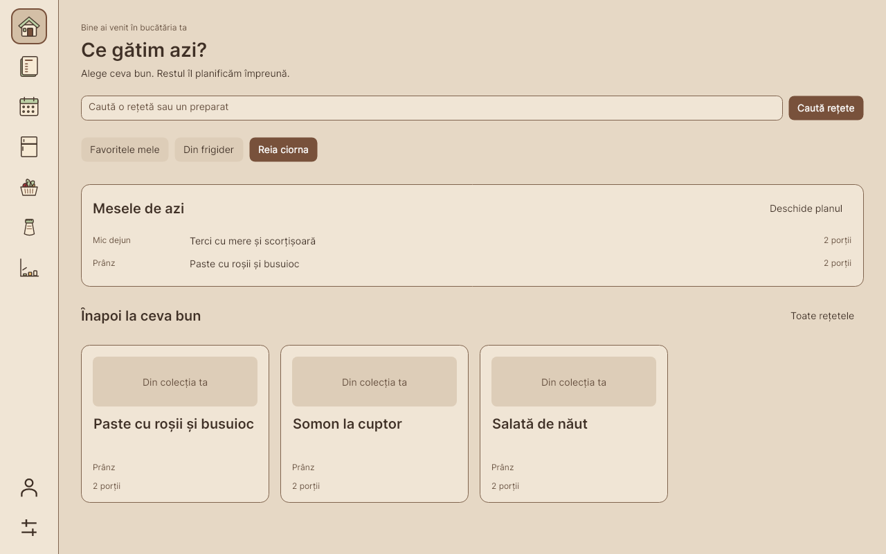 |
| Home, dark, compact | 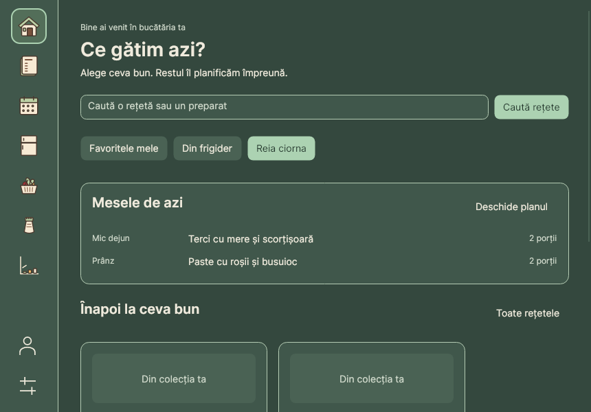 | 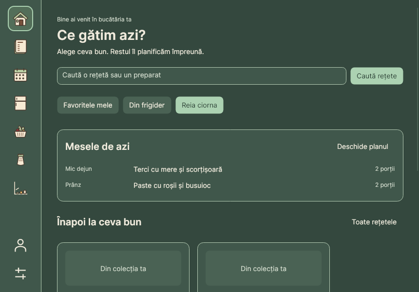 |
| Fridge, light, wide |  | 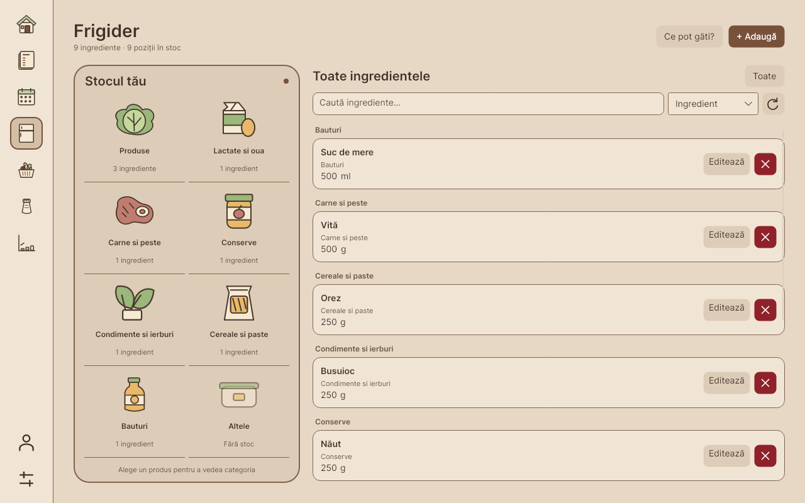 |
| Fridge selection, light, wide | 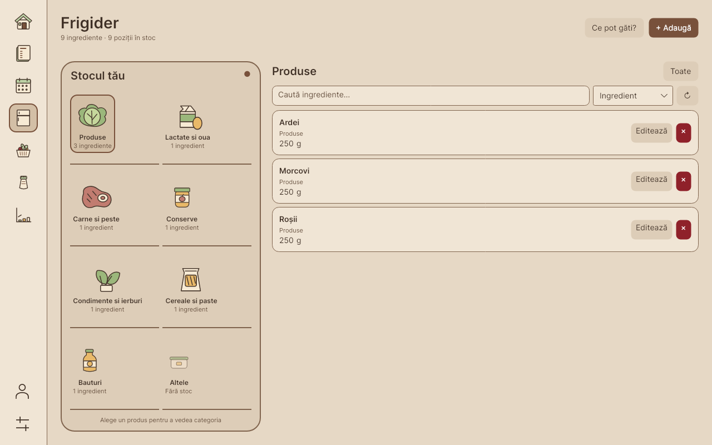 | 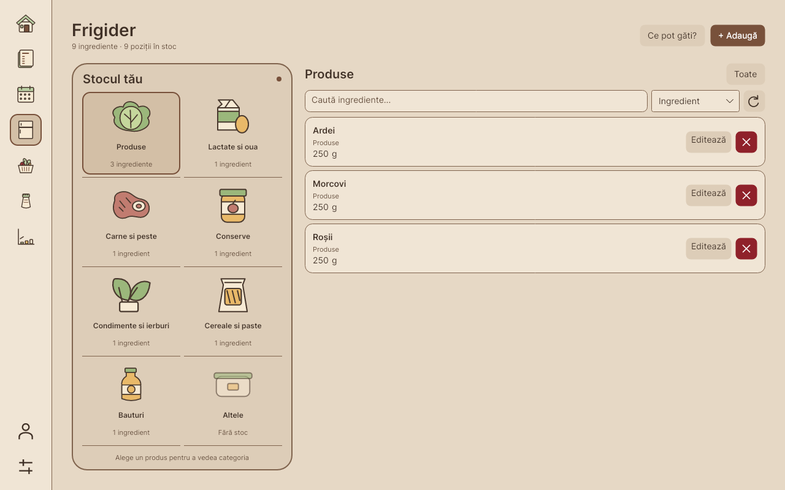 |
| Fridge selection, dark, compact | 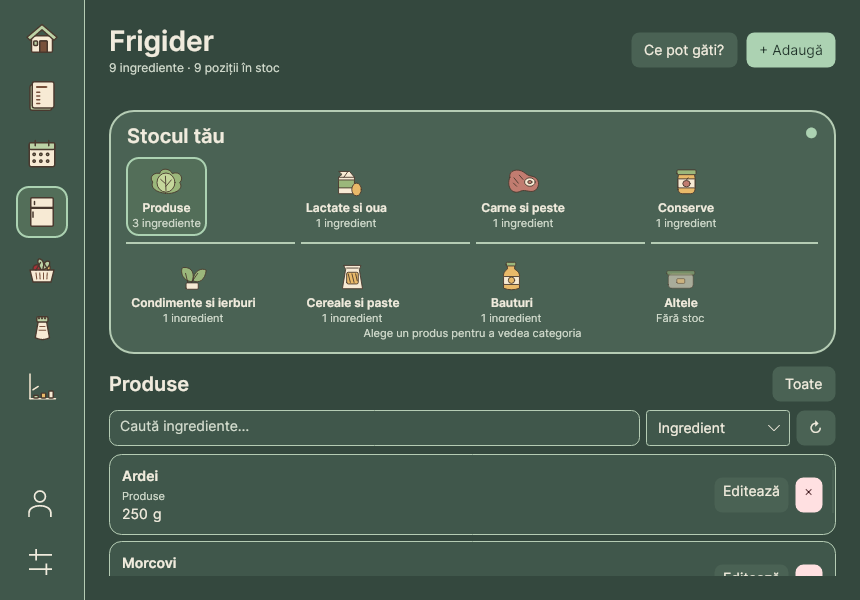 | 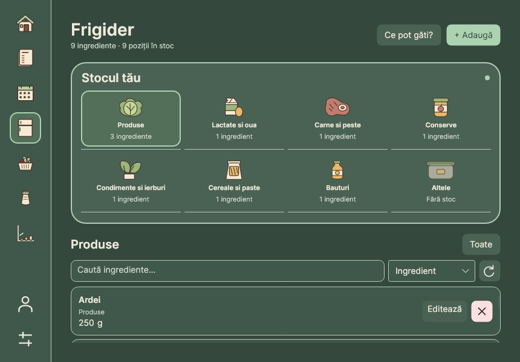 |
| Fridge, dark, large, 150% export | 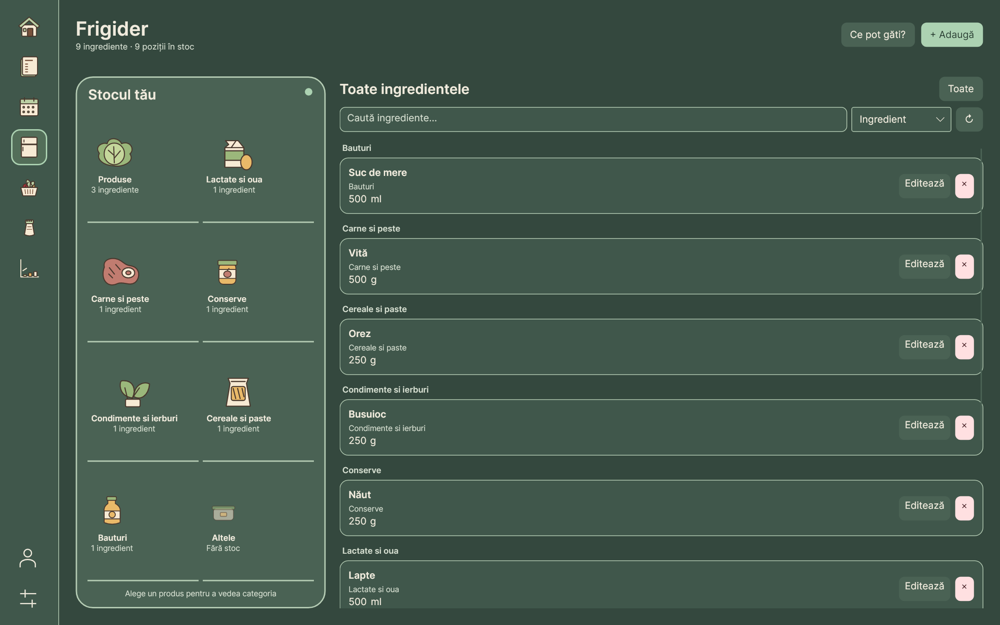 | 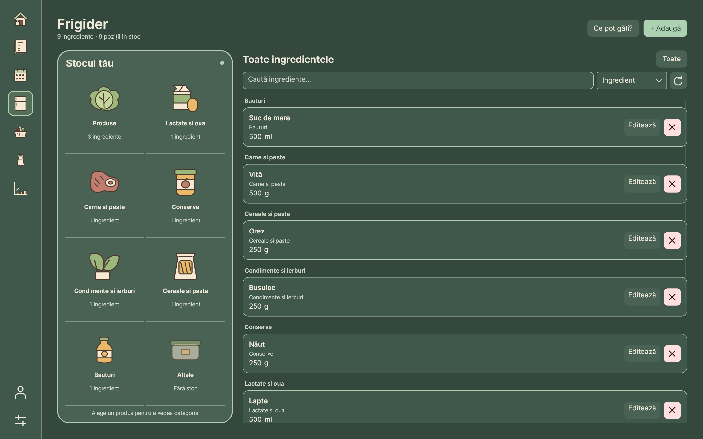 |
| Recipes, light, wide | 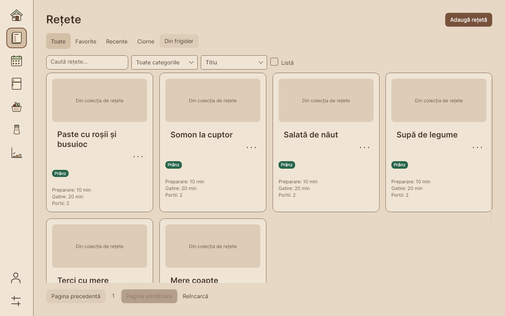 | 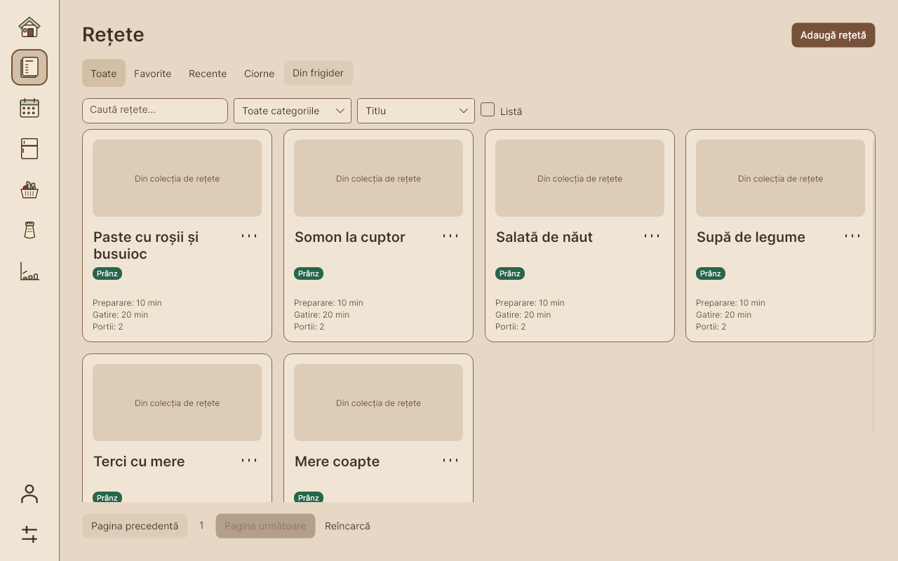 |
| Recipes, dark, compact | 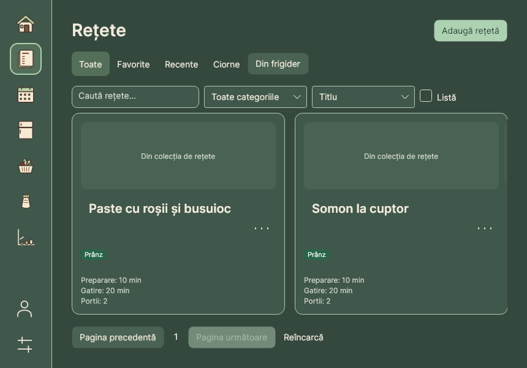 | 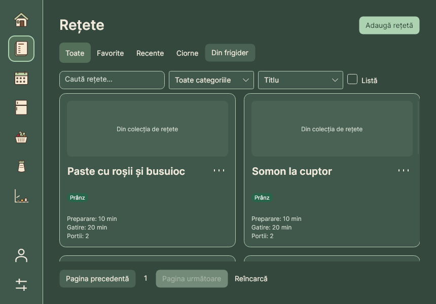 |

## Changes

- Fridge buttons fill equal shelf cells, with centered, fixed-size illustration slots.
  The drawing transform centers the actual artwork rather than each shape's original
  artboard. Label areas and count lines share consistent positions.
- Transparent borders reserve selection/focus space so choosing a category cannot move
  its icon or text. Compact shelves retain all eight counts; long labels have tooltips.
- Fridge page margins match the other pages. The status light, refresh and delete marks
  use vector shapes. Empty notifications no longer reserve a blank text line.
- Home recipe cards align titles to photos and reserve consistent title space; section
  headings are vertically centered beside their actions.
- Recipe and draft titles share a row with a centered action button. Titles start at the
  photo/metadata edge, reserve two lines, and keep category badges and timings aligned.
- Profile and Settings use centered 24-unit drawing canvases in the rail footer, avoiding
  the offsets produced by stretching non-square geometry into square Path controls.

## Validation

The Release build and all 50 regressions pass using per-test Avalonia dispatcher isolation.
The fridge layout regression checks illustration/label centers, common row positions,
selection stability, visible compact counts, keyboard activation and 2,000-row virtualization.
Contrast checks retain 70 text pairs ≥4.5:1 and 16 control/focus pairs ≥3:1. Release packaging
and Windows packaging script tests pass (6 and 7 tests respectively).

The baseline set has 268 renders. The focused after set has 90: Home, recipes and three fridge
states, both themes, three window sizes and 100%/150%/200% bitmap export scales. SHA256
manifests are retained beside this document; only the representative images are committed.
Regenerate the focused set with the direct runner's `--alignment-screenshots` option.

The macOS ARM64 app bundle is cross-built on Linux. Native Mac alignment/DPI acceptance
and the new Compatibility CI run remain separate checks. No Core, SQL or WPF changes were
required. The standard VSTest TCP listener remains unavailable in this sandbox.
