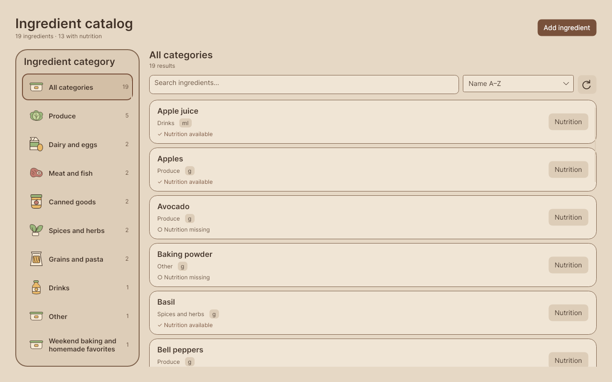
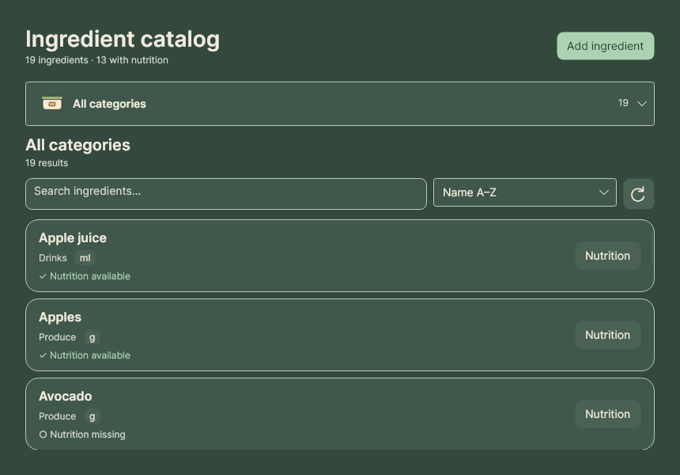
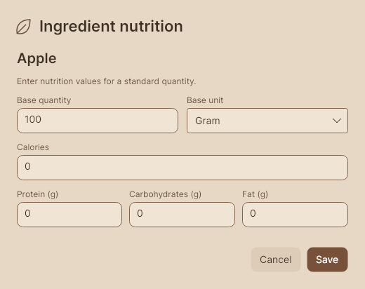
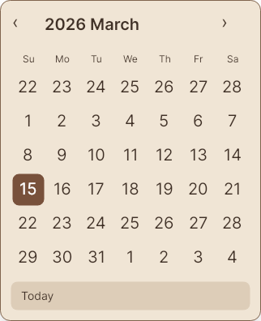

# Ingredients, dialogs, and calendar

Ingredients uses an illustrated category rail beside a virtualized ingredient list,
with the pantry's warm theme palette, food drawings, 32px page margins, and rounded surfaces.
Horizontal category entries keep this browsing layout distinct from the pantry shelves.
The header summarizes total ingredients and nutrition coverage. Results show the selected
category and matching count above an expanding search field, sort selector, and refresh action.
Cream cards in Light mode and green surfaces in Dark mode show the ingredient name,
category, default-unit badge, neutral nutrition availability, and the existing Nutrition editor action.

The catalog has immediate search and four sort options:
Name A–Z, Name Z–A, Category, and Missing nutrition first. At narrow widths the category
rail becomes an illustrated dropdown below 1000px of **view** width. Header actions and
toolbar controls move to additional rows as space narrows. Category counts describe the complete catalog; search and
category selection intersect. Custom categories and uncategorized ingredients remain visible.
Empty categories are selectable. Unknown category names keep their text and use the existing
food-box illustration. Missing nutrition is informational; no inline nutrient estimates are added.





The client reads the full catalog on load, refresh, and confirmed ingredient or nutrition
changes. Search and sorting use the cached source and issue no repository reads. Refresh
preserves selection, search, and sorting; cancelled or superseded reads cannot replace newer
results. The shared collections, grouping, and legacy ingredient command remain available
to WPF. Database and procedure contracts are unchanged. The bounded ListBox uses a
VirtualizingStackPanel with no surrounding ScrollViewer; only viewport rows are realized.
Category and result lists support arrow-key navigation, and the compact dropdown preserves
the same category selection when resizing. Nutrition remains a keyboard-accessible button.

## Dialogs and popovers

App dialogs use owned native windows, 24px margins, a heading, a scrolling form body, and
fixed footer actions. Long forms fit within a 560px content height. Connection testing has
its own row so translated Cancel and Save actions remain together on the right. Destructive
confirmations use explicit action labels and danger styling. Escape cancels when available;
Enter does not submit multiline notes or an open autocomplete selection. Notifications
remain non-modal and OS file pickers remain native.



Dropdowns, suggestions, menus, tooltips, and calendar popovers share opaque warm surfaces,
rounded corners, and semantic theme colors. No entrance animation is required. Existing
reduced-motion preferences and live language switching remain available.

The calendar keeps Avalonia's selection logic and required template parts. It offers
40px day targets, six weeks, month/year navigation, a selected accent, a separate today
outline, and a localized Today action. Today obeys date limits and blackout dates. Choosing
a date closes the picker and returns focus. Language changes preserve selected and displayed
dates and the text editor buffer; regional formatting and week start follow system settings.



Design references: [Apple alerts](https://developer.apple.com/design/human-interface-guidelines/alerts)
and [GNOME dialogs](https://developer.gnome.org/hig/patterns/feedback/dialogs.html).

## Reproduce validation

```bash
dotnet test Tests/MealPrepApp.Tests/MealPrepApp.Tests.csproj -c Release
python3 Tests/Scripts/check_localization.py
python3 Tests/Scripts/check_redesign_contrast.py
dotnet run --project Tests/MealPrepApp.RegressionRunner -c Release -- --catalog-screenshots
dotnet run --project Tests/MealPrepApp.RegressionRunner -c Release -- --ingredient-catalog-screenshots
```

The database-free capture matrix writes to `dist/catalog/screenshots/{en,ru,ro}`. It covers
Light/Dark, 860×600 / 1280×800 / 1440×900 catalog sizes, 100% / 150% / 200% bitmap exports,
all form types, validation, confirmations, unsaved changes, settings, connection setup,
calendar day/month/year views, dropdowns, autocomplete, menus, and tooltips. Public dialog
examples here are English. Shell captures can be refreshed with `--localization-section=ingredients`.

The dedicated ingredient-catalog command renders 90 database-free captures to
`dist/catalog-redesign/screenshots/{en,ro,ru}`: three languages × two themes × three sizes ×
five states (all, selected, custom, empty category, and error). It includes every built-in
illustration, long custom names, uncategorized ingredients, and both nutrition statuses.
Public examples include all 18 language/theme/size combinations plus representative states;
[the manifest](screenshots/catalog-manifest.json) records dimensions, state, and image hashes.

The regression suite checks local intersections and sort results, complete category counts,
custom and uncategorized entries, refresh preservation, stale reads, confirmed nutrition
refreshes, dialog actions, and calendar constraints. Existing localization checks cover dirty
editors and active cooking sessions.

The redesign regressions also verify localized summary notifications, category illustration
identities, category/result arrow keys, compact-dropdown keyboard selection, selection
preservation on resize, and first-to-last scrolling through 2,000 ingredients with fewer
than 31 realized row containers. Layout assertions cover all three languages and both
themes at the required sizes, plus 600px and the 1000px breakpoint, including long category
titles, empty categories, uncategorized entries, errors, and visible retry controls.

Validation on 2026-11-11: all 111 xUnit tests passed; 598 translation keys and
placeholders matched; 70 semantic text pairs met 4.5:1 contrast and 16 control/focus
pairs met 3:1. Catalog generation checks and the disposable SQL suite passed,
including repeat imports, existing-value preservation and audited nutrition inserts.

Headless exports verify layout and rendering; they do not establish native window-manager,
DPI, keyboard, popup repositioning, or installer acceptance. Keep these acceptance gates
separate for the exact release commit:

| Platform | Native acceptance |
|---|---|
| Windows | Required before release; include WPF Compatibility build |
| macOS | Required before release; retain native window controls and file picker |
| Linux | Required before release; verify popup placement and keyboard focus |

Use Compatibility CI for platform tests and packaging. Release publication remains manual.
