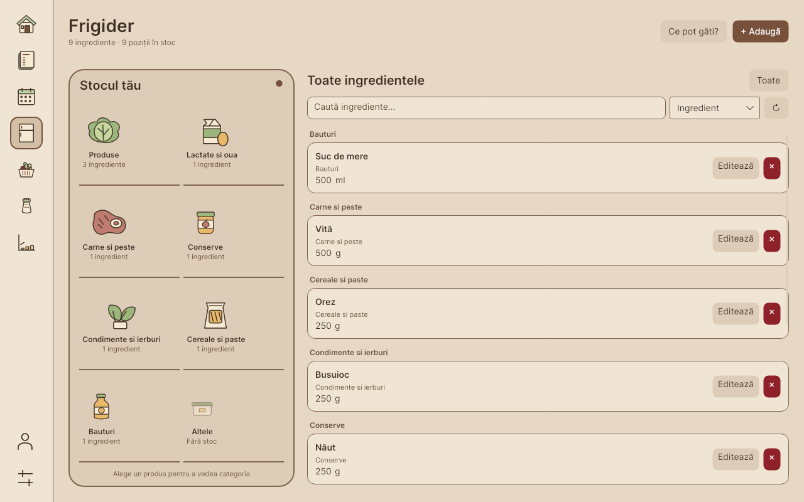

# Illustrated Frigider and animation completion

Implemented on 2026-10-30. Avalonia uses an illustrated fridge with category buttons,
stock counts and a virtualized ingredient list. Wide layouts keep stock beside the
shelves; compact layouts use four columns above the stock. Select a food to filter its
category, or use **Toate** for grouped stock. Empty categories remain accessible. Search
and sorting are local; quantity editing, adding and confirmed removal retain the existing
stored procedures. **Ce pot găti?** prepares the pantry recipe filter before navigation.

The eight existing database categories retain their names and assignments. Unknown
categories use a generic container. Illustrations use cached native vector geometry,
without image decoding, animation timers or additional dependencies. Category selection
preserves keyboard focus. Ingredient rows use a bounded virtualizing list. Population
rebuilds projections once; category clicks, search and sorting make no repository calls.
Refreshes overlap stock and category reads, cancel predecessors and reject stale results,
errors and busy updates. Failed reads retain displayed stock and can be retried. Mutations
visibly disable conflicting stock controls; filters survive refreshes.

Navigation animations use forward fill so the clock releases its value at the final pose,
without briefly exposing the old value. Entry/hold/reset, interruption and reduced-motion
behavior are retained. The pepper shaker has no falling particles.

## Verification

- Release Desktop/Core/test-runner build: zero warnings or errors.
- Direct regression runner: 50/50, including actual Avalonia clock completion/reset,
  keyboard category activation, compact/wide layout, 2,000-row virtualization, local
  filtering, initialization retry, cancellation/disposal and stale responses.
- Stock action fixtures cover add/edit validation, cancelled deletion, failed deletion,
  retry and visibly busy mutation state. These use repository fakes, not a live database.
- Semantic contrast: 70 text pairs ≥4.5:1 and 16 control/focus pairs ≥3:1.
- Packaging script tests: release 6, Windows 7, branch consolidation 4; updater tests 3.
- macOS ARM64 app bundle and Linux x64 self-contained publish checks passed on Linux.
- 268 headless renders (hashes verified) cover both themes, 860×600 / 1280×800 / 1440×900 DIP, exported at
  100% / 150% / 200%. Additional selected/empty fridge samples and icon progress frames
  are included. Run the regression runner with `--refinement-screenshots` to regenerate
  the full matrix in `dist/refinement/screenshots`; representative renders are retained here.

Standard VSTest execution is blocked by sandbox TCP-listener permissions; the direct
runner invokes the same 50 test methods in process. 635 tracked paths pass the Windows
checkout compatibility check.

WPF's shared markup type test passes; native WPF compilation is blocked locally by the
missing `Microsoft.WindowsDesktop.App.Ref` package. Disposable SQL tests are blocked by
Docker socket permissions. No SQL/schema changes or live database writes were made.
Compatibility CI and native hover/DPI testing on Windows, macOS and Linux remain separate
acceptance steps. The headless matrix does not establish native scaling or hover acceptance.
Rebuild the Mac app after pulling this commit before testing the changes.

## CI clock regression repair (2026-10-30)

Codrin supplied Compatibility logs for `908fe2a`: the reset assertion in
`NavigationActualClockCompletionNeverExposesTheOldPose` failed on all three desktop
runners (49/50 passed on each). The same failure was reproduced locally by switching
the direct runner from a shared application to Avalonia's per-test headless sessions,
matching xUnit's dispatcher isolation.

The real-clock test now asynchronously yields between render ticks and awaits animation
completion with a five-second timeout. It retains the final progress, released animation,
and monotonic completion/reset assertions. The direct runner keeps per-test isolation
and accepts `--filter=NavigationActualClock` for targeted reproduction.

The Release build passed without warnings/errors; all 50 tests passed using the isolated
runner (see [updated results](ci-regression-results.txt)). Standard VSTest remains blocked
locally by sandbox socket permissions. The follow-up Compatibility run on Windows, macOS
and Linux must still pass; no native acceptance is inferred from this repair.
