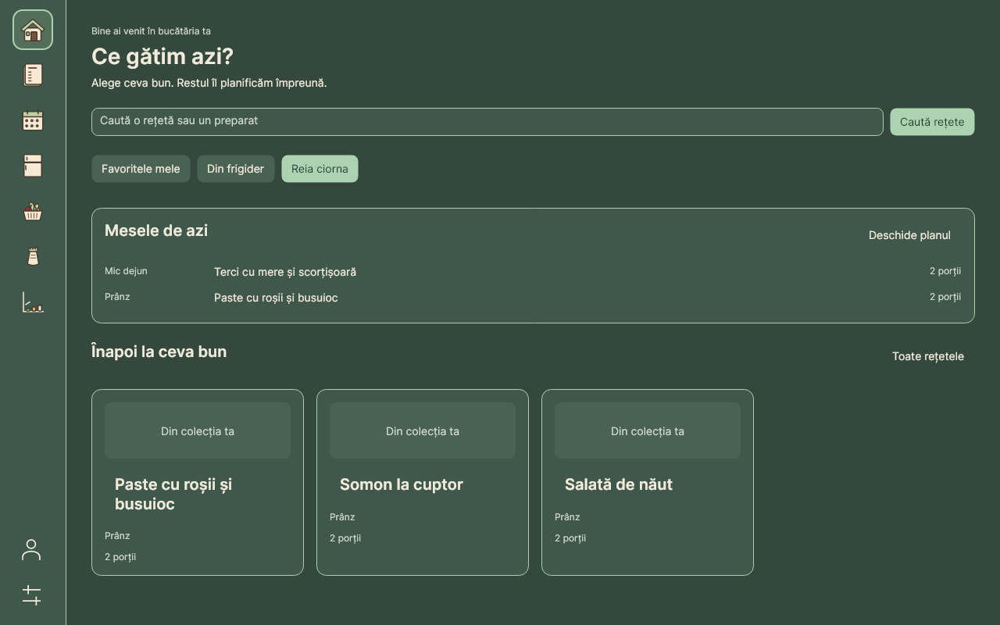

# Appearance and navigation

Screenshots in this directory are historical Romanian localization evidence. See the
[refreshed English captures and localization matrix](../localization/README.md) for the
English-default application.

Use Settings to choose System, Light, or Dark appearance and the reduced-motion preference. The navigation rail provides direct access to the seven app sections, with profile and Settings below. Localized tooltips identify each icon; Tab, arrow keys, and Enter/Space support keyboard navigation.

The following dated reference records theme, interaction, and validation work. For current installation instructions, use the [platform guides](../platforms/).

Local implementation and evidence recorded on 2026-10-29, on Linux.
Avalonia remains the primary Windows, macOS and Linux client. WPF remains available as a legacy Windows client.
No SQL schema, stored-procedure contract, release workflow or publication policy changed.



The desktop uses beige/brown and brighter sage semantic palettes, including
Fluent input, dropdown, calendar, menu, tooltip and selection resources. Primary,
secondary and destructive buttons retain their roles on hover and press. Placeholder
text uses full opacity; error-dialog headers use `OnDanger`. Pages share 32-DIP outer
spacing, 36-DIP minimum controls, inline errors, loading indicators and recovery actions.
System/Light/Dark and the existing reduced-motion setting remain available.

The 84-DIP rail has seven 52-DIP destination buttons with 36-DIP native vector illustrations.
Profile and Settings stay in the footer; the destination area scrolls independently.
Localized accessible names, tooltips, native window controls and menus remain. Tab and
arrow keys move focus, Enter/Space activate buttons, and modified arrow shortcuts remain
available. Selection follows committed navigation, including rejected editor leave prompts.

Each icon runs one 780 ms Avalonia clock animation on entry/focus, holds its completed
pose while engaged and resets in 180 ms after both leave. Re-entry cancels the previous
sequence. Completion, reduced motion and visual detach release animation work. Reduced
motion shows static illustrations immediately. The animation runner seam is internal;
production uses Avalonia's clock without another animation dependency.

Client fixes include:

- Recipe and ingredient initialization completes only after lookups and rows succeed;
  retry reloads missing initialization data.
- Snapshot reads cancel predecessors, capture the requested ID, and reject stale results
  and stale busy/error updates. Selection remains available during reads. Mutations
  visibly disable conflicting controls and commands until their refresh finishes.
- Optional cancellation tokens reach drafts, pantry matching, lookups, snapshots and
  dashboard reads; cancelled repository calls stop before opening a connection.
- Navigation preparation executes after leave guards approve. Home recipe shortcuts
  batch their filters before one destination load, including on retained pages.
- Ingredient grouping and pantry projection notifications are deferred during population.
- Home overlaps at most four independent reads, captures its user/date once and rejects
  completions after disposal or a newer load. Disposal is safe when DI and navigation
  both own a retained page.

## Automated evidence

| Check | Result |
|---|---|
| Release build of Desktop and direct runner | Passed, zero warnings/errors |
| Direct in-process regression runner | 44/44 passed |
| Semantic and Fluent text contrast | 70 pairs ≥ 4.5:1 |
| Essential border/focus contrast | 16 pairs ≥ 3:1 |
| Database-updater script tests | 3 passed |
| Release packaging tests | 6 passed |
| Windows packaging/installer script tests | 7 passed; no native installer execution |
| Branch consolidation helper tests | 4 passed |
| Repository path check | Passed |
| Self-contained Linux x64 publish | Passed |
| Self-contained macOS arm64 cross-publish | Passed; no native launch |
| WPF markup/Core type mapping | Passed in the direct runner |
| WPF compilation | Blocked: WindowsDesktop reference pack unavailable locally |
| Standard VSTest discovery/execution | Blocked: sandbox denies its local TCP socket |
| Disposable SQL suite | Blocked: Docker socket access denied |
| Push and Compatibility CI | Pending: GitHub DNS/network access unavailable |

The client workflow regression exercises recipe search, serving scaling, cooking,
planning, shopping generation, saved purchase state and explicit pantry import, including
validation and mutation failure/recovery. It uses controlled repositories. It establishes
client behavior; SQL integration and native end-to-end acceptance remain separate.

The direct runner includes deterministic entry/hold/interruption/reset/reduced-motion
animation checks, detach/resource changes, keyboard activation, rejected navigation,
lookup recovery, snapshot races, stale recipe/ingredient responses, query counts,
cancellation, grouping and bounded dashboard loading. It does not replace standard test
discovery on CI. Disabled controls are intentionally dimmed; contrast checks cover enabled
text and essential indicators.

## Render evidence

The complete generated set is under gitignored `dist/refinement/screenshots/`:

- 180 shell renders: seven destinations plus recipe detail, cooking and the component
  gallery; Light and Dark; 860×600, 1280×800 and 1440×900 DIP; 100%, 150% and 200% bitmap scales.
- 10 illustration strips: 0%, 25%, 50%, 75% and 100% animation progress in both themes.
- 42 auxiliary renders: login, registration, Settings, connection setup, ingredient and
  planning dialogs, and an error dialog, in both themes at all three bitmap scales.

[The render manifest](render-manifest.json) records all 232 PNGs, byte counts and hashes.
Representative 100% captures and all icon strips are retained in [screenshots/](screenshots/).
The seven destinations were checked at each minimum-size/theme combination; larger and
scaled representative captures were inspected as well. Headless bitmap scale is export
resolution, not proof of OS DPI behavior. Icon strips set progress explicitly and do not
establish native hover timing. [Native acceptance](native-acceptance.md) remains pending.

| Destination | Light | Dark |
|---|---|---|
| Acasă | [View](screenshots/home-Light-1280-100.png) | [View](screenshots/home-Dark-1280-100.png) |
| Rețete | [View](screenshots/recipes-Light-1280-100.png) | [View](screenshots/recipes-Dark-1280-100.png) |
| Planificare | [View](screenshots/planner-Light-1280-100.png) | [View](screenshots/planner-Dark-1280-100.png) |
| Frigider | [View](screenshots/pantry-Light-1280-100.png) | [View](screenshots/pantry-Dark-1280-100.png) |
| Cumpărături | [View](screenshots/shopping-Light-1280-100.png) | [View](screenshots/shopping-Dark-1280-100.png) |
| Ingrediente | [View](screenshots/ingredients-Light-1280-100.png) | [View](screenshots/ingredients-Dark-1280-100.png) |
| Rapoarte | [View](screenshots/reports-Light-1280-100.png) | [View](screenshots/reports-Dark-1280-100.png) |

Reproduce the local checks without MSBuild worker sockets:

```bash
dotnet build Tests/MealPrepApp.RegressionRunner -c Release -m:1 -p:UseSharedCompilation=false
dotnet Tests/MealPrepApp.RegressionRunner/bin/Release/net10.0/MealPrepApp.RegressionRunner.dll
dotnet Tests/MealPrepApp.RegressionRunner/bin/Release/net10.0/MealPrepApp.RegressionRunner.dll --refinement-screenshots
python3 Tests/Scripts/check_redesign_contrast.py
```

Run standard `dotnet test` and the remaining README checks in an unrestricted environment.
After pushing `main`, require a green **Compatibility** run for that exact commit, including
Windows Desktop tests, WPF compilation, installer execution, all platform packages and SQL
checks. No Windows-only result is claimed here. Release publication stays manual.

Recipe-detail screenshots and their recorded hashes were refreshed with a neutral demo account. Other dated validation results retain their original scope.
